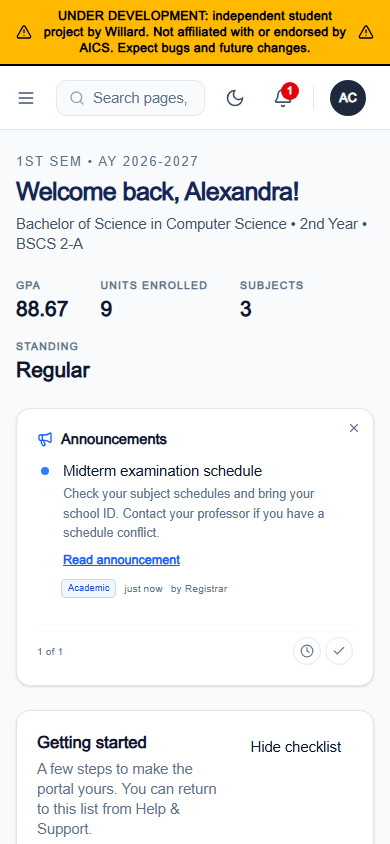
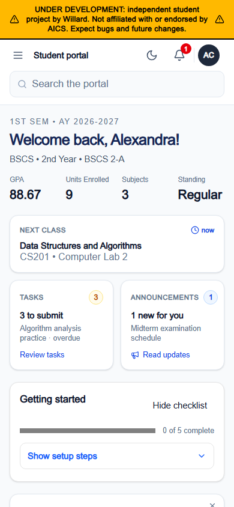
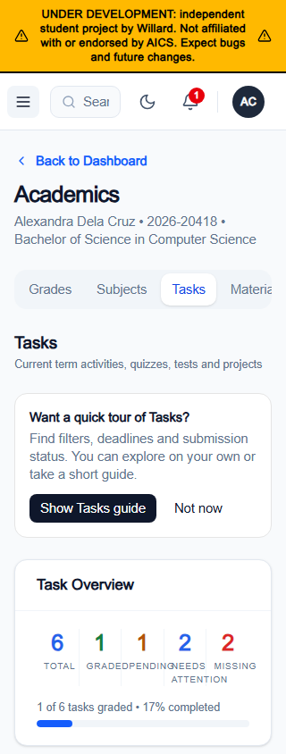
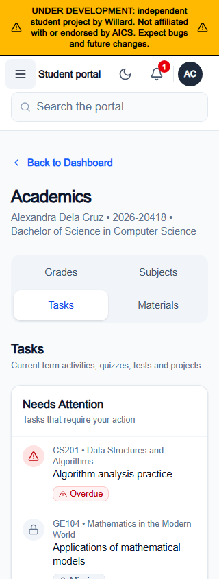
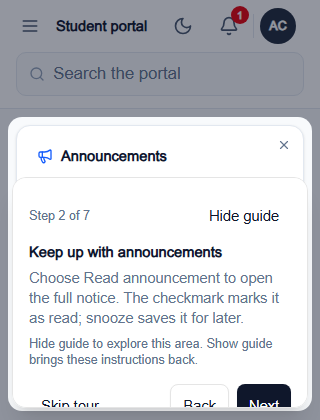
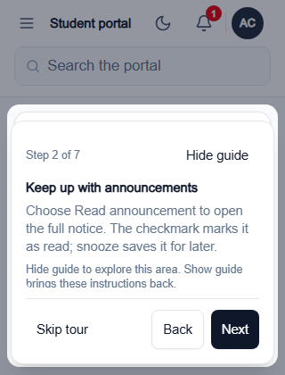
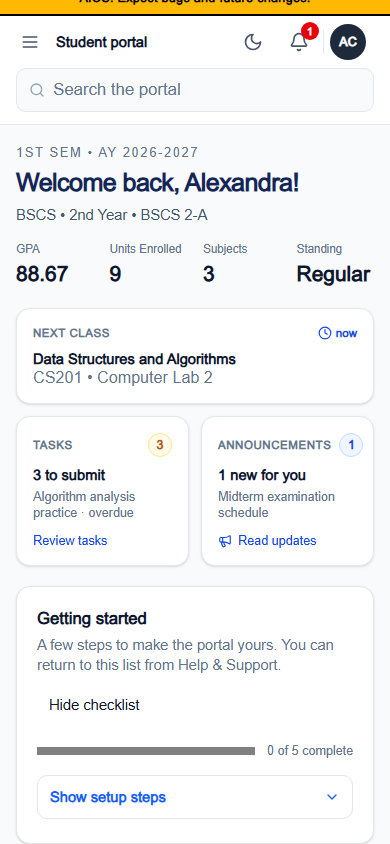

# Student mobile layout review

The student portal now gives phone users usable search, visible academic sections and earlier access to daily coursework. Urgent tasks precede summaries and guidance. Long names and document actions reflow, and students can use the short-screen guide without losing access to the page it explains.

Reviewed application source: [`a3e1f33`](https://github.com/Hachiiki/AICSPortal/commit/a3e1f336996c8d7d9fc70aabd51379298480d905). Feature PR: [#95](https://github.com/Hachiiki/AICSPortal/pull/95), targeting `main-full-dev`.

## Verification

| Check | Result | Evidence |
| --- | --- | --- |
| Full browser acceptance | 314 passed, 0 failed, 0 client errors | [Result](verification/acceptance.json) |
| Student reflow | 15 route states at 320, 360, 390, 430, 768, 1024 and 1280 CSS pixels | [Final screenshots](final), 105 route/width combinations |
| Compiled source match | 207 source/public files matched the checkout by SHA-256 | [Quality report](verification/quality.json), [manifest](manifest.json) |
| Lint | Passed | [Log](verification/lint.log) |
| Typecheck | Passed | [Log](verification/typecheck.log) |
| Production webpack build | Passed | [Log](verification/build.log) |
| Relevant unit regressions | 154 passed, 0 failed, 728 expectations across 11 files | [Log](verification/unit-tests.log) |
| Independent council | Both reviewers consider the examined version ready for PR review | Tables below |

The browser run uses Chromium 156.0.8078.4 with synthetic student, faculty and administrator fixtures. All API requests are intercepted; task and onboarding writes are simulated. The preview uses isolated local settings and does not load the checkout environment files or write school records. Browser results are checked against a successful production build before running.

The student matrix covers Dashboard, Grades, Subjects, Tasks, Materials, Events, Enrollment, Professors, Profile, the five Settings sections and Help. Interactions cover drawer Tab/Shift+Tab/Escape/inert/focus restoration, grouped search keyboard order, pointer and touch selection, repeated same-page task selection, real URL reload, notification destinations, filters/reset/retry, simulated submission, long task details, Digital ID, certificate actions/print width, welcome, checklist, both tours, nested Escape, Alt+G, short-screen guide minimize/explore/restore and sign-in inputs. Shared faculty and administrator checks cover role-aware navigation, drawers and restricted search, rather than complete staff workflows.

## Council scores

Exactly two independent agents reviewed the work. Their instructions requested evidence-based scores and concrete findings without disclosing a numerical target. They reviewed source, screenshots and recorded browser checks; they did not conduct user studies or personally operate physical devices.

The visual reviewer rechecked the exact `151272b` baseline and replaced the earlier provisional scores from a reused older build. The usability review began with source-risk scores; the exact baseline screenshots subsequently corroborated those findings. Both final tables apply to `a3e1f33` and acceptance-r10.

### Visual council, GPT-6.1 Sol, extra high

| Dimension | Baseline /10 | Current /10 | Assessment |
| --- | ---: | ---: | --- |
| Layout | 4.5 | 8 | Narrow controls, tabs, forms and document actions reflow clearly. |
| Typography | 5.5 | 7.5 | Subject and material names are readable. Some secondary metadata remains small. |
| Spacing | 5 | 8 | Controls have consistent separation and the collapsed checklist is smaller. |
| Visual hierarchy | 4.5 | 8 | Daily work and urgent tasks precede setup and summary content. |
| Density | 4.5 | 7.5 | Collapsed filters and compact setup reduce scrolling. Repeated context still takes phone space. |
| Coherence | 7.5 | 8 | Shared typography, colors, cards and controls remain consistent. |
| First-use clarity | 5.5 | 8 | Guide navigation stays visible; Hide/Show exposes the announcement action and restores instructions. |
| Student task priorities | 4 | 8 | Routing and urgency wording agree; classes and submission work are easier to find. |

Verdict: ready for review, with no remaining blocking visual finding in the examined evidence. Remaining suggestions concern small secondary metadata and repeated page context.

### Usability council, GPT-6.1 Terra, extra high

| Dimension | Baseline /10 | Current /10 | Evidence and limits |
| --- | ---: | ---: | --- |
| Navigation / discoverability | 6 | 8 | Tiny search and clipped section choices are resolved; task and notification destinations are exercised. |
| Touch targets | 4 | 7.5 | Header, filters, Events switch and guide footer have checked 44px mobile targets. No exhaustive device audit. |
| Phone reflow | 4 | 8 | Listed student views pass four phone widths; root-width checks alone cannot prove every child avoids clipping. |
| Modal / tour | 4 | 8 | Submission, certificate and short-screen guide controls are visible; minimize/open/restore is exercised. |
| Keyboard / accessibility | 4 | 7.5 | Drawer, guide focus, nested Escape and search are exercised. Screen readers, voice control and real mobile keyboards are untested. |
| Feedback / errors | 6 | 8 | Filtered-empty/reset, failed-load retry and simulated successful submission pass. Real service failures remain untested. |
| Task completion | 5 | 8 | Same-page task selection and simulated submission pass. No real-account end-to-end write. |
| Shared desktop / faculty | Unverified | 7 | Student desktop matrix and faculty/admin chrome smoke pass. Complete staff workflows remain untested. |

Verdict: ready for PR review, with no confirmed blocker in the examined evidence. Scores are review judgments bounded by the tested cases, not measurements from a user study.

## Before and after

Screenshots are unaltered browser captures. Historical app files were exported from each commit, verified against Git blob hashes, built in an isolated temporary directory and rendered with the same synthetic data, viewport sizes and reference date. Calendar time advances normally; performance clocks, timers and animation frames are native. The manifests distinguish freshly built snapshots from a source-matched verified-build reuse.

| Screen | Before | After |
| --- | --- | --- |
| Dashboard, 390px |  |  |
| Tasks, 320px |  |  |
| Guide navigation, 320x420 |  |  |
| Collapsed setup, 390px |  |  |

1. The header gives search a full phone row and preserves reachable primary actions.
2. Dashboard daily work and Tasks Needs Attention appear ahead of optional setup, summaries and guidance.
3. The guide keeps its header and navigation visible while instructions scroll. Hide guide exposes the announcement action; Show guide restores the same step.
4. The collapsed setup card uses less vertical space and reveals its explanation when expanded.

The [minimized guide](final/guide-minimized-320x420.png), [submission confirmation](final/submission-320.png), [short-screen certificate](final/certificate-clean-320x420.png), [Materials](commits/a3e1f33/materials-320.png) and [Settings](commits/a3e1f33/settings-security-320.png) provide additional examples. The original chained acceptance screenshot is preserved even where a transient Tasks success toast remains visible. The additional certificate capture uses a fresh fixture context and records full opacity with no toast in its [capture report](verification/clean-certificate.json).

## Commit comparisons

Each implementation commit has a PR Conversation comment with its exact parent comparison, image table, numbered explanations and verification notes. A screenshot cannot establish keyboard or network behavior, so those changes also reference the final browser assertions.

| Commit | Change | Capture directory |
| --- | --- | --- |
| `151272b` | Development plan and original app baseline | [Baseline](commits/151272b) |
| `0f2dfb4` | Phone navigation, academic layouts, task URLs, daily work and responsive dialogs | [Capture](commits/0f2dfb4) |
| `0cb4ae1` | Coursework priority, deadline wording, collapsible filters and unobstructed actions | [Capture](commits/0cb4ae1) |
| `af226f5` | Search ordering, guide polish and repeatable verification helpers | [Capture](commits/af226f5) |
| `23b33a7` | Populated Materials, forms, Digital ID and certificate layout | [Capture](commits/23b33a7) |
| `f03c908` | 16px phone sign-in inputs and CommonJS helper compatibility | [Capture](commits/f03c908) |
| `a1ecf25` | Events switch, Settings grid, course-card ordering and repeat-search focus | [Capture](commits/a1ecf25) |
| `02cd462` | Minimize/restore guide and corrected calendar fixture | [Capture](commits/02cd462) |
| `a3e1f33` | Pinned guide actions, keyboard focus, compact setup and final verification | [Capture](commits/a3e1f33) |

The early `af226f5` helper failed CI because its `.cjs` filename triggered a lint-plugin scoping issue. The rename in `23b33a7` exposed two CommonJS import exceptions, documented precisely in `f03c908`. Subsequent required CI checks passed. No lint rules or build gates were weakened.

## Failed runs and scope limits

The [earlier search failure](verification/prior-search-failure.json) exposed delayed task focus stealing a second search. `a1ecf25` lets an active search or edit take priority. Final pointer, touch and repeat-search checks pass.

Full runs [r6](verification/acceptance-r6.json), [r7](verification/acceptance-r7.json) and [r8](verification/acceptance-r8.json) failed around submission rendering/dismissal. They are retained as failures. A controlled reload comparison recorded opacity zero under the [Playwright fixed clock](verification/clock-playwright-fixed.json), and opacity one with the [native date offset](verification/clock-date-offset.json). The fixture now offsets calendar dates without replacing performance timing or animation frames. The source-matched [r9 run](verification/acceptance-r9.json) passed 310 checks before the final guide refinement; r10 passed 314 on the final application source. No production opacity override was added to conceal a failure.

This review does not establish real iOS/Android behavior, screen-reader or voice-control support, 200% zoom coverage, complete staff workflows, or live-account task submission. Profile document actions that already show coming-soon feedback remain existing limitations outside this layout change. Authentication, grade persistence and school-data contracts were not extended.

The evidence and scripts are development artifacts for `main-full-dev`. They must not be merged wholesale into production `main`; a production port requires the repository's separate release workflow and authorization.
